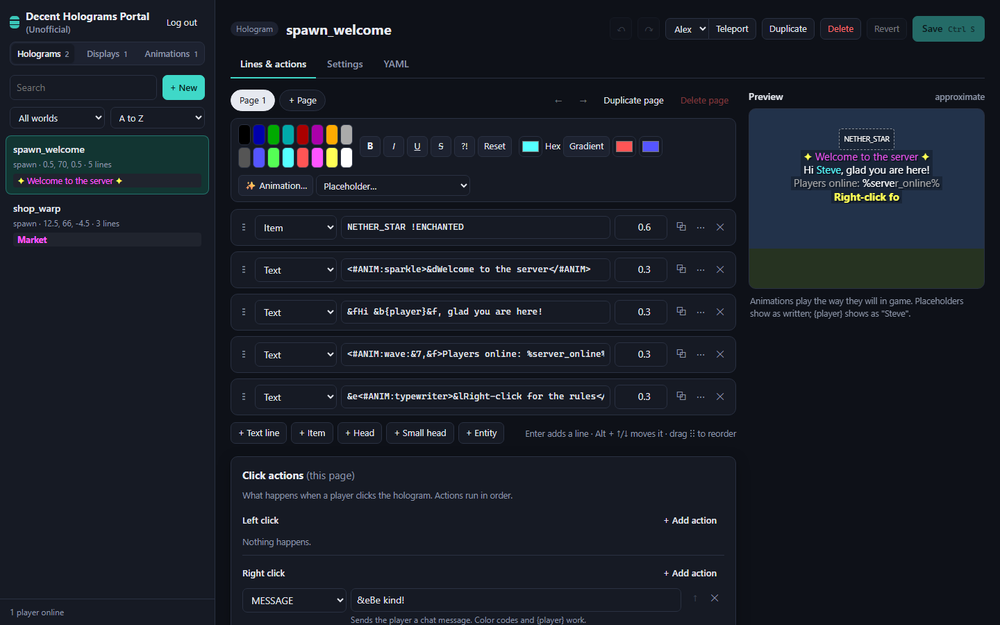
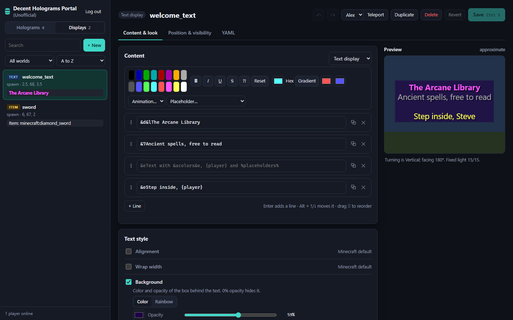
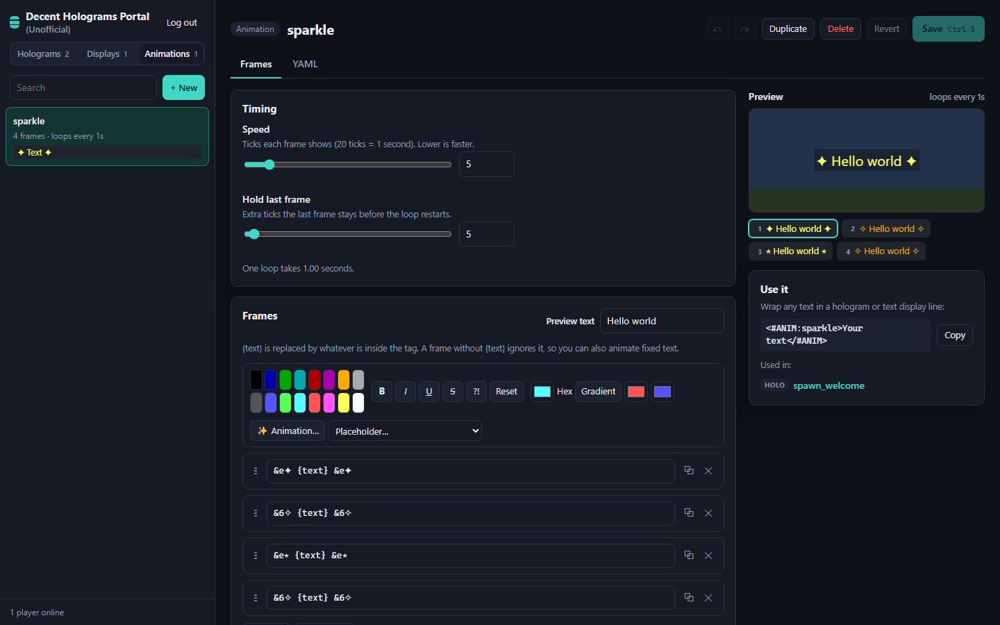
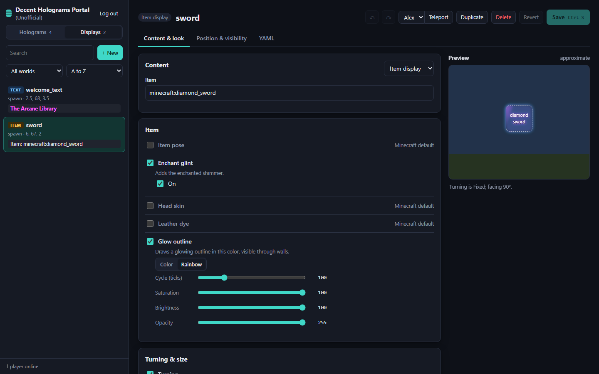

# (Unofficial) Decent Holograms Portal

A web editor for [DecentHolograms](https://github.com/DecentSoftware-eu/DecentHolograms). Edit every hologram, display and animation in your browser instead of typing `/dh` commands, with a live animated preview, and see your changes in game the moment you save.

It runs inside your Minecraft server as a small plugin (**HoloPortal**). There's nothing else to install or host.

> Not affiliated with or endorsed by DecentSoftware. Please don't send them bug reports about this plugin; open an issue here instead.



## Features

**Holograms**
- Text, item, head, small head and entity lines, with a live preview
- A formatting toolbar: color codes, bold and friends, hex colors, animations and PlaceholderAPI placeholders
- A gradient & rainbow builder: presets (rainbow, pastel, sunset, fire, ocean, aurora...) or up to 8 of your own colors. It uses DecentHolograms' native `<RAINBOW1>` and two-color gradient tags, and chains two-color pieces for longer gradients without splitting placeholders or animations
- An asset picker with real Minecraft icons: every item and block (images from [mcasset.cloud](https://mcasset.cloud)), player heads by name, pasted textures, and ~94,000 custom heads from [minecraft-heads.com](https://minecraft-heads.com), searchable by category
- Item options as fields: enchant glint, head value and NBT/components (`PLAYER_HEAD (Notch) {CustomModelData:1} !ENCHANTED`)
- Every entity DecentHolograms can show, with spawn-egg icons. Entities it can't show (rockets, TNT, boats, minecarts...) can be shown as an item instead in one click
- Animations play in the preview exactly as they do in game, and lines with a broken or misused animation tag get a hint
- Pages, and click actions for left, right and shift clicks (message, command, console command, teleport, sound, next/previous page, permission checks...)
- Per-line height, offsets, facing, permission and flags
- Location, facing, display/update range, update interval, permission, flags and down origin
- Templates for new holograms: welcome sign, clickable warp, item showcase and a 3-page info board

**Displays** (text, item and block display entities, DecentHolograms 2.10+)
- Text lines, or the item or block
- Every attribute: turning (billboard), size, offset, rotation, fixed lighting, shadow, alignment, wrap width, background color (solid or rainbow), text opacity, text shadow, see-through, glow outline, item pose, enchant glint, leather dye and head skin
- Leave any attribute on the Minecraft default with one click



**Animations**
- Pick an animation from a list where every option plays live on your own text, set its colors, and it's wrapped in the right `<#ANIM:…>` tag for you
- Create custom animations: frames with the formatting toolbar, speed and hold timing, presets (color cycle, blink, sparkle, arrows, gradient shine) and a live preview with a frame strip
- See which holograms and displays use each animation, copy its tag, and get warned before a rename breaks them



**Editing**
- Undo and redo (Ctrl+Z / Ctrl+Y), Ctrl+S to save
- Enter adds a line, Alt+↑/↓ moves it, drag the handle to reorder
- Create, duplicate, rename and delete; teleport an online player to any hologram; edit the raw YAML file
- Use an online player's position or facing, center on a block, and nudge positions in 0.1-block steps
- Search, filter by world, and sort by distance to an online player
- If someone changes a hologram in game while you have it open, the editor picks up their change. Saving never silently overwrites it.
- Works on phones too



## Requirements

- A **Paper** server (or a Paper fork) on Minecraft **26.1 or newer**, running **Java 25**
- Tested on Paper 26.3 with DecentHolograms 2.10.2-SNAPSHOT; built against DecentHolograms 2.10.1
- **DecentHolograms 2.10.0 or newer**

## Install

1. Download `HoloPortal-x.y.z.jar` from [Releases](../../releases) and put it in `plugins/`.
2. Restart the server. HoloPortal generates a password in `plugins/HoloPortal/config.yml`.
3. Open `http://<your server's LAN IP>:8790` in a browser and log in, or run `/holoportal link` in game for a one-time login link.
4. If you can't connect, allow TCP port 8790 through the server machine's firewall for your local network.

## Commands and permission

| Command | What it does |
|---|---|
| `/holoportal` (alias `/hp`) | Shows the editor's address |
| `/holoportal link` | Gives you a one-time login link (valid for 5 minutes) |
| `/holoportal reload` | Reloads `config.yml` and restarts the web server |

All commands need `holoportal.admin` (ops have it by default).

## Configuration

```yaml
port: 8790            # web editor port
bind: 0.0.0.0         # 127.0.0.1 = this machine only
public-url: ""        # address used in /holoportal links; empty = this machine's LAN IP
password: ""          # generated on first start
session-hours: 12     # how long a login lasts
```

## Security

**Keep the editor on your local network. Don't forward the port on your router.** Click actions can run console commands, so anyone who can log in can effectively run any command on your server. Logins use a password or one-time link, sessions are HTTP-only cookies, and repeated wrong passwords lock that address out for 5 minutes. If you need remote access, put it behind a VPN (e.g. Tailscale) or an HTTPS reverse proxy with its own authentication.

## How it works

- **Holograms:** saving writes the hologram's file in DecentHolograms' own format and has DecentHolograms load it again (the same path `/dh reload` uses), so anything DecentHolograms can store, the editor can set. If DecentHolograms rejects the file, the previous version is restored.
- **Asset picker:** `icons.json` maps every item to its inventory icon (a flat sprite or the three faces of a cube). It's generated from the vanilla assets by `node tools/gen-icons.mjs <version>`; re-run it for a new Minecraft version. The head library is downloaded by the server from minecraft-heads.com's public lists, trimmed to name, tags and texture hash, and cached in `plugins/HoloPortal/heads/` for a week (`heads.library: false` turns it off). Set `heads.app-uuid` (and `heads.api-key` for a license) to use their API v2 instead.
- **Animations:** custom animations are files in `plugins/DecentHolograms/animations/` (`speed`, `pause` and `steps`). Saving writes the file and reloads DecentHolograms' animations. The preview uses a port of DecentHolograms' animation code, including its quirks: the built-in typewriter, wave, burn and scroll drop color codes inside the tag, and a custom animation's last frame only shows when its pause is at least its speed.
- **Displays:** DecentHolograms doesn't offer a plugin API for displays yet, so the editor writes the display's file in `plugins/DecentHolograms/displays/` and asks DecentHolograms to reload its displays. Every display briefly respawns when you save one. Warnings DecentHolograms logs about the display (for example a skipped attribute) are shown in the editor, and the old file is restored if the display doesn't load.
- The web server is the JDK's built-in HTTP server and the editor is plain HTML, CSS and JavaScript, so the plugin has no extra dependencies.

## Building

```bash
./gradlew build
```

The jar lands in `build/libs/`. Pass `-PmcVersion=26.3` to build against a different Paper API version.

## License

GPL-3.0, the same as DecentHolograms. See [LICENSE](LICENSE).
